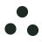
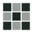

# Audit — buttons and ports

_Created 2026-11-27 · Updated 2026-11-27_

Comprehensibility items 2 and 4 in TODO, next in the practitioner's UI order of 2026-11-26 after the commentary
sweep. Item 2: *one style per role (primary action, secondary, link-like, label), one place for a step's primary
action. Measure: buttons whose style does not match their role.* Item 4: *choose one model [of input ports], or two
with a stated rule, and draw only the ports a step can use. Measure: ports drawn and ports connected, per widget, in
the worked examples.* Read from the code at 0.203.0 (branch `sweep-second-pass`, from `c7b25d6a`). Nothing was
changed for this audit.

**Decided by the practitioner, 2026-11-27:** the four button roles, applied to every button in one release; and
ports by the model already settled on 2026-10-15, below. This audit first put the question again as models A
and B; it was not open.

## Buttons

**How it was counted.** Every `<button>` written in `index.html`, `src/*.ts` and `src/*.tsx`, with its class and its
label as written. A label built at run time is counted once, as written. Buttons drawn by a library (React Flow's
zoom controls, Leaflet's) are not counted.

| Class | Buttons |
| --- | --- |
| `button small` | 176 |
| `button` | 124 |
| `button primary` | 82 |
| `text-button` | 24 |
| `chip` (and `chip notes-open`, `chip lab-only`, `chip flowlink`) | 19 |
| `icon-button` | 10 |
| `button danger`, `button small danger` | 9 |
| one-offs: `manual-button`, `learn-link`, `config-close`, `grow`, `manual-copy`, `identity-button`, `column-sort`, `storage-pill`, `pub-write`, `library-toggle`, `app-version` | 17 |
| no class | 23 |

**Findings.**

1. **Twenty labels are drawn in more than one style.** *Close* in four (`button`, `button grow`, `button primary`,
   `button small`); *Remove* in three (`button small`, `chip`, `text-button`); *Manual* in three (`chip`, `tab`,
   `text-button`); *Next* in three; *Apply*, *Configure…*, *Edit*, *Find*, *Data quality*, *Previous*, *Start
   again*, *Stop*, *Copy*, *Open*, *Notes audit*, *Clear draft*, *Download GeoTIFF*, *Open my identity*, *Use zone…*
   and the close mark *×* in two each.
2. **Primary marks things that do not commit.** Among the 33 labels styled `primary` are *Close*, *Next*, *Step*,
   *Open*, *Done* and *Keep them open*, beside the ones that do commit: *Apply*, *Save*, *Run workflow*, *Create
   project*. A primary button reads as "this is what the surface is for"; on *Close* it says the dialog is for
   closing.
3. **Size stands in for role.** `button` and `button small` are the same role in different places: 176 small and 124
   regular, with the same label small in one dialog and regular in the next (*Data quality*, *Find*, *Previous*).
4. **Four ways to look like a link.** `text-button`, `learn-link`, `manual-button` and `chip` all lead somewhere
   rather than act. *Manual* alone is a chip, a tab and a text button.
5. **The step's primary action is in one place on the standard Inspector**, *Configure…* under Settings, and is
   `button primary` there, except on Street network (`src/network-input-ui.ts`), where it is a plain `button`.

**Measure, today:** 20 labels in more than one style; 6 labels styled primary that do not commit.

**The rule, adopted 2026-11-27.** Four roles, one style each, size set by where a button sits
(toolbars and bars small, dialogs regular) and never by role:

| Role | Style | For |
| --- | --- | --- |
| Primary | `button primary` | The one action a surface or dialog is for, which commits: Apply, Save, Run, Create. At most one per surface. |
| Secondary | `button` | Every other action: Close, Next, Previous, Data quality, Find. |
| Destructive | `button danger` | Removes or discards: Delete workflow, Remove node, Start again where it discards. |
| Link | `text-button` | Leads somewhere and changes nothing: Manual, Evidence, Version. |

Chips stay for labels and filters, not actions; a chip that acts (the note card's *Open*, TODO's first instance)
becomes a link or a button.

**Applied in 0.204.0, 2026-11-27.** `npm run measure:buttons` counts every button by the four roles, and
`tests/buttons-by-role.test.mjs` holds both counts at zero:

| Measure | At the audit (by hand) | After |
| --- | --- | --- |
| Labels drawn in more than one role | 20 | 0 |
| Primary buttons that do not commit | 6 | 0 |

The script counts roles, not sizes, so a button small in a toolbar and regular in a dialog is one role. Its first count,
at 0.203.0, found 9 labels in more than one role and 51 Primary buttons whose label is not a committing verb. What changed:

- **Close, Next, Done, Step and Keep them open** are Secondary.
- **Configure…** is Primary on every Inspector, Street network's included (finding 5). It opens the dialog where the
  step's settings are committed, so it is the one main action and is counted as committing; so is Deduplicate's
  **Review…**.
- **Open** stays Primary in the identity and sealed-file dialogs, where opening the file with its passphrase is what
  the dialog does. This corrects finding 2, which listed it among those that do not commit.
- **Remove** is Danger everywhere it was drawn (twelve places), and the first **Start again** in georeferencing,
  which leads to the confirmation that discards the pairs. The walkthroughs' **Start again**, which discards nothing,
  reads **Back to step 1**.
- **Use zone**, **Stop** and **Edit** act, so they are Secondary, not links.
- **Manual**, the note card's **Open the note** (it read *open*) and a write-up's **Open the map** lead somewhere, so
  they are links. The lab's **Add a problem** and the note's **Evaluate** act, so they are buttons. Chips stay for
  the note editor's formatting and for filters.

## Input ports

**How it was counted.** Each worked example's workflow as it ships (`EXAMPLE_TEMPLATES`, the eleven keys other than
`blank`), three ways, because they differ (corrected 2026-11-27 from pull request 9's review, which counted the
drawn handles in Chromium; the first count here took the declared ports for the drawn ones):
- **declared:** the ports the step's contract lists, as `nodeInputs` gives them;
- **drawn:** the input handles the canvas renders, counted in Chromium on each example's canvas (`.react-flow__handle.target`);
- **connected:** the ports an edge arrives at.

| | Declared | Drawn | Connected | Drawn, not connected |
| --- | --- | --- | --- | --- |
| All eleven workflows, 89 nodes | 260 | 164 | 95 | 69 |
| Map, 14 nodes | 117 | 49 | 35 | 14 |
| Point data, 16 nodes | 32 | 32 | 0 | 32 |
| Table, 14 nodes | 56 | 28 | 14 | 14 |
| Chart, 9 nodes | 18 | 18 | 9 | 9 |
| Every other widget together, 36 nodes | 37 | 37 | 37 | 0 |

**Findings.**

1. **Map and Table already draw close to what is connected.** Each draws its connected layers and one free port to
   add the next (14 free on 14 Maps, 14 on 14 Tables). Of the 117 ports Map's contract declares, 49 are drawn.
2. **Point data and Chart draw ports that are not used.** Point data's two optional ports, a table and an area, are
   drawn on all 16 nodes and connected on none: 32 of the 69 drawn and unused. Chart draws both its ports and uses one.
3. **Four port models** (fixed, inferred from the wiring, switched by a setting, counted), as TODO records. Map's
   point layers are counted (`pointInputCount`), its others fixed.
4. **A port is unnamed until hovered on most widgets.** Nine of the 53 live widgets draw a named row per input
   (`spatialPorts` in `src/canvas.tsx`, with `PORT_NAMES` and `PORT_GROUPS` in `src/port-names.ts`: Map, Table, Chart,
   Raster input, Clip raster, Sample a raster, Join a table to the study area, Geometry buffer, Travel time over
   ground). On the other 44 a port is
   an 11 px dot whose name (`.handle-name`) is at opacity 0 until hovered, and is the port's id (`records`,
   `candidates`), not its name in words. The Inspector's Inputs section names every port in words, and is the way in
   for anyone who cannot hit an 11 px dot.
**Measure, today:** 164 input handles drawn and 95 connected in the eleven worked examples, so 69 drawn and unused;
260 declared.

**The model, settled 2026-10-15 and not reopened.** The practitioner, of Map: *"Instead of cluttering the side of
the map widget with input ports, the Inspector UI should offer 1 configurable port but also enable addition of more
input ports"* (quoted in `src/canvas.tsx`; built the same day, `docs/todo-history.md`, *A map has layers, not
modes*). Experiment [116](../experiments/116-model-builder-sideways.md), the same day, set the rule for when the
shape is not enough: *bind silently when one port fits, ask when more than one does*, and extend the configurable
port from the Map to every widget. Join a table to the study area (2026-11-20) and Geometry buffer (2026-11-23) were
brought to it one at a time, through `PORT_GROUPS`, when the practitioner met each in the running app.

The practitioner restated it on 2026-11-27: *"Nodes should automatically detect the shape of the incoming input on
an unconnected input port and once connected should display in words what came in. Then it adds a blank port to
accommodate another input if it's configured to receive more."*

**What is left to build, read at 0.203.0:**

- **The one configurable port on every widget with inputs**, not only Map and Table (the `layer` handle, bound by
  `layerPortFor` in `src/app.ts` from what the source emits, `outputOf`). 44 widgets still draw a dot per port.
- **A connected row says in words what came in**, its kind and where it came from, not the port's id.
- **Another blank port only while the step can take more**: a declared port still free, or a counted one that can
  grow (`pointInputCount` and the like).
- **Where more than one free port fits the shape, the canvas asks which** (116): Measure distance (from, to), Travel
  time over ground (start from, places), Relate tables, Compare point sets, sea-level site assignment. Ports of one
  kind with one role (Append rows, Deduplicate points, a border's two areas) fill in order, as Map's point layers do.
- **Unchanged underneath:** the declared ports stay what saved workflows, receipts and port contracts are written
  in; the Inspector's Inputs list stays the way in by keyboard.

**Built in 0.204.0, 2026-11-27.** Every widget with inputs draws the inputs connected, each with its kind's symbol
and the source's name, and one blank port, **+ Add an input**, while it can take more (Map: **+ Add a layer**, while
something on the canvas could add one; a polygon layer of study areas, while it can take another). A drop on the blank
port is bound by what arrives; where more than one input fits, the canvas asks, by role: Measure distance's **From**
and **To**, Travel time over ground's **From** and **To**, Relate tables' **Main** and **Related**, Compare point sets'
**Original**, **Moved** and **Reference**. Tested in `tests/one-blank-port.browser.mjs`, Chromium only.

**One output connector per node** (the practitioner, the same day): on the node's right edge, with no row; hovering it
shows the kind's symbol and its name. **Nodes got shorter to make room:** a widget's description, the same on every
node of its kind, shows on the selected node only. Overlapping node pairs in the eleven built-in examples went from
13 at 0.203.0, to 27 with the port rows, to 0 (`tests/examples-do-not-overlap.browser.mjs`).

**On screen, polygons are "Areas"**, as the Map's and Table's outputs and the Inspector already said them; the key
below calls the kind "Polygons". The words on the screen were kept, so as not to give one kind two names there.

## The port symbols, chosen 2026-11-27

The practitioner, of a connected row reading "Points from Health facilities": *"too long. ... Since we have a finite
set of input types ... can we make them recognizable symbols so the name of the type can be displayed with it?"* A
connected row shows the kind's symbol and the source's name (**symbol** Health facilities), cut with "…" where it
does not fit; the full wording is on hover and in the Inspector's Inputs list. Where two free ports take the same
kind for different roles, the role comes first in muted text (From Cases, To Health facilities).

Chosen from a sheet of mock nodes in light, dark and high contrast, at the canvas's size and twice it. Each symbol is
drawn in the text colour, so it has the contrast of the words beside it; it never stands without the name. The
files are in [port-symbols/](port-symbols/); the code takes them in 0.204.0.

| Symbol | Kind | Carries |
| --- | --- | --- |
|  | Points | Points; a mean centre |
|  | Lines | Lines |
|  | Polygons | Polygons |
|  | Study area | Study area |
|  | Table | Tables; Measure distance's distances; an Apply ruleset result (all three shipped rulesets declare a table) |
|  | Raster | Rasters; satellite files and products |
|  | Street network | Street network |
|  | Map image (ground) | A georeferenced map image |
|  | Study design | Study design, into Two-by-two, Regression and Rate ratio |

Thirteen kinds reach a live widget's port; the nine symbols cover them. The reasoning result and the coverage check
have no live source: every widget that produced either is retired, so neither has a symbol, and Table's *Or:
Coverage result* port, the one live port that still takes a coverage check, goes in 0.204.0. Point data and Raster
input share the node icon ▦; each source widget's icon becomes the symbol of the kind it sends.

## What this does not establish

That any of these get in a practitioner's way: they are read from the code and counted, not observed. Labels built
at run time may differ from the label written. The port counts are the shipped worked examples, not workflows people
have built; the drawn count is Chromium's, at the size the canvas opens.
