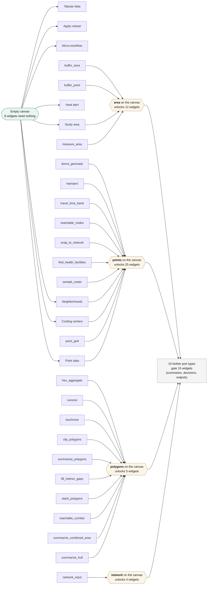

# 112 — Progressive widget reveal

_Created 2026-10-14 · Updated 2026-10-14_

**Status:** tried — the rule is applied to every shipped example and measured against
declared contracts, which is the observation stage AGENTS.md says is usually skipped. It
is not implemented in the interface, and nobody has watched a practitioner meet either
version of the palette.

Proposed by the practitioner on 2026-10-14, while revisiting the widgets the names
inventory marks *"example templates only"*:

> Once there is a study area, it reveals/or activates the next widgets that will
> feed from study area output. The other widgets otherwise remain inert or
> unaddable.

And then: *we can embed that in the ontology as rules.*

This record is the **observation** stage — the one
[AGENTS.md](../../AGENTS.md) says is usually skipped between proposing a rule and
enforcing it. The rule is applied to what exists and measured. It is not
implemented.

## The gate is the port, not the widget

"Once there is a study area" is really "once an `area` exists", and four widgets
can supply one. Keying the rule on **port types** rather than on named widgets is
what makes it answer the question a practitioner has — *what do I need on the
canvas to reach this?* — and what makes it expressible as a rule over the graph
rather than a list someone maintains.


The diagram is generated by `scripts/widget-reveal.mjs` from `src/core.ts#TYPES`.
A picture of what unlocks what is worth nothing if it is maintained apart from the
contracts it claims to describe.

## Corrected 2026-10-14: the first measurement read a union as a conjunction

The first version of this record reported that **`map_output` could never be
revealed**, because it declares four inputs — `area`, `points`, `coverage`,
`raster` — and the rule required all of them. The practitioner's response was that
a map should activate once there is a point, polygon, raster or any other mappable
output, which is correct, and checking why it did not found that the measurement
was wrong rather than the widget.

**`TYPES[t].inputs` is not a contract.** It is a union across alternative
contracts selected by the node's `inputMode`:

| `map_output` mode | ports it actually requires |
| --- | --- |
| `polygons` | `polygons` |
| `raster` | `raster` |
| `network` | `network` |
| `decisions` | `decisions` |
| `spatial` | `area` + `points` |

So a map in polygons mode needs one input, not four. `nodeInputs(node)` already
resolves this from the node's parameters — the knowledge exists, and is reachable
only by constructing a node and asking.

**The same mistake was in the port graph itself.** Checking every edge in the six
shipped examples against the declared ports found **13 widget/port pairs used by
examples and declared nowhere**:

> `map_output.polygons`, `map_output.decisions`, `map_output.context`,
> `table_output.polygons`, `table_output.decisions`, `chart_output.polygons`,
> `chart_output.series`, `case_series.cases`, `apply_ruleset.distances`,
> `apply_ruleset.alert`, `apply_ruleset.facilities`,
> `compare_point_sets.originalCenter`, `compare_point_sets.movedCenter`

Every one of them runs. The declaration is simply not where the behaviour is.

**And a third layer.** `nodeInputs` returns the ports a node MAY take;
`executionPlan` then drops those it does not insist on — `coverage` always,
`raster` unless the map is in raster mode — before refusing a missing connection.
Restating that filter in this script to get the same answer is itself the finding:
one contract, written twice, in two files, with nothing holding the copies
together.

## What the rule does, measured correctly

Over the 53 live widgets, starting from the 8 that need nothing:

| Semantics | Revealed per step | Never revealed |
| --- | --- | --- |
| every declared input (**wrong**) | 24 → 19 → 1 → 1 | 0 |
| any declared input (**too loose**) | 36 → 9 | 0 |
| **any contract satisfiable** (correct) | **27 → 16 → 1 → 1** | **0** |

`map_output` is revealed at **step 1**, as soon as an area and points exist or any
mappable output does. `isochrone` at step 2, once a network exists.

A fourth defect surfaced while fixing this. Requiring a contract to have at least
one port stranded **five** widgets: `network_input` declares an `area` it does not
insist on — a country can name the scope instead — so its required set is empty,
and demanding a non-empty one orphaned it along with everything consuming a
`network`: `isochrone`, `reachable_corridor`, `reachable_nodes`,
`snap_to_network`. **A contract with no required ports is satisfied by
definition.** One wrong `&&`, five widgets hidden — the shape of defect this
analysis exists to find, found in the analysis.



The diagram is generated by `scripts/widget-reveal.mjs` (`npm run reveal:widgets`)
from `src/core.ts`, and verified to parse against Mermaid 11.4.1. A picture of what
unlocks what is worth nothing if it is maintained apart from the contracts it
claims to describe.

## What actually blocks it

Not the reveal rule — the declarations it would have to read.

A widget's real contract is assembled at run time from three places:
`TYPES.inputs` (a union, and incomplete by 13 pairs), `nodeInputs` (resolves the
mode), and a filter inside `executionPlan` (drops the ports it does not insist
on). **None of that is declared where a rule could read it**, and only one widget
records any of it: `network_input`, whose release file carries
`optionalInputs: ["area"]` — the same fact the code states separately, so the one
widget that declares it declares it twice. The other 44 declare nothing.

**This is the prerequisite, and it is worth doing whether or not reveal ships.**
Declaring each widget's contracts — the alternatives, and which ports each one
requires — in the release records and the ontology, then having `executionPlan`
read the declaration instead of rebuilding it, turns a contract spread across
three code paths into one a rule can query. It is this project's own principle,
*mechanised rules enforce; prose rules describe*, applied to a rule that is
currently neither. It would also catch the 13 undeclared ports, which nothing
catches today.

## Does it bind?

The second test in AGENTS.md, and the one this proposal has to answer honestly:
**what would it prevent?**

It would prevent building output-first — dropping a map on the canvas and wiring
inputs to it afterwards. That is how a lot of people sketch, and it is how several
of this project's own examples read when laid out. The palette already does a weak
version of the idea: `STARTER_TYPES` offers 5 widgets on a blank canvas. Going
from "5 on blank" to gated at every step is a much stronger claim about how
practitioners work, and no evidence here supports it yet.

The cost is also asymmetric. A crowded palette wastes attention; a hidden widget
can make a practitioner conclude the application cannot do something it can.

## Port types, in full

| Port | Produced by | Unlocks | Widgets it gates |
| --- | --- | --- | --- |
| `access` | 1 | 1 | `access_policy` |
| `alert` | 1 | 1 | `policy` |
| `area` | 4 | 12 | `buffer_area`, `voronoi`, `network_input`, `clip_polygons`, `raster_input`, `find_health_facilities`, `clip_raster`, `facilities`, `point_grid`, `measure_area`, `coverage_check`, `map_output` |
| `coverage-check` | 1 | 2 | `map_output`, `table_output` |
| `decisions` | 4 | 2 | `chart_output`, `output` |
| `distances` | 2 | 2 | `travel_time`, `policy` |
| `facilities` | 1 | 1 | `xpert` |
| `gradedFacilities` | 1 | 1 | `access` |
| `network` | 1 | 4 | `isochrone`, `reachable_corridor`, `reachable_nodes`, `snap_to_network` |
| `point-comparison` | 1 | 1 | `comparison_map` |
| `points` | 11 | 25 | `mean_center`, `compare_point_sets`, `donut_geomask`, `hex_aggregate`, `voronoi`, `isochrone`, `summarize_polygons`, `rate`, `case_series`, `slr_site_assignment`, `reproject`, `travel_time_band`, `reachable_corridor`, `reachable_nodes`, `snap_to_network`, `summarize_hull`, `buffer_point`, `sample_raster`, `measure_distance`, `facilities`, `access`, `facility_audit`, `coverage_check`, `map_output`, `table_output` |
| `polygons` | 10 | 5 | `clip_polygons`, `summarize_polygons`, `fill_interior_gaps`, `stack_polygons`, `summarize_combined_area` |
| `raster` | 2 | 3 | `sample_raster`, `clip_raster`, `map_output` |
| `table` | 5 | 3 | `slr_extract_import`, `slr_site_assignment`, `slr_threshold_comparison` |

## What this does not establish

It does not establish that progressive reveal helps anyone. It establishes that it
would orphan nobody and that it cannot be implemented correctly on the contracts
as they are declared today.

It does not establish that the strict reading is the wrong one in general — only
that it is wrong for the three output widgets, which is enough to block it.

It does not measure the thing that matters most: whether a practitioner facing 31
addable widgets is helped by seeing 6. Nobody has been watched using either.

## The blocker is cleared, 2026-10-14

`widgets/port-contracts.json` now records, for each of **53 widgets**, every contract it
has — the alternatives selected by a parameter, which ports each alternative **requires**
and which it merely **accepts**. `executionPlan` no longer rebuilds that answer inline:
`requiredInputs` holds it in one place, and the contracts file is generated from it and
regenerated by a validator that fails on drift.

**Honestly, it is a mirror and not a source.** This record asked for the declaration to be
authoritative — for `executionPlan` to read it. It does not: the code is still where the
contract lives and the file is derived from the behaviour, so it starts true and a drift
check keeps it true. What that buys is the thing the reveal rule needed, which is a
contract a rule can query without reading three code paths. What it does not buy is a
contract a widget author states and the code obeys. The difference matters for the
ontology half of the practitioner's proposal — *we can embed that in the ontology as
rules* — because a rule in the ontology would be reading a generated mirror of the code
rather than a declaration the code is held to.

### What the rule would do, measured from the contracts

A widget is revealed when **one** of its contracts has every required port already
produced. Run to a fixpoint from an empty canvas:

| Wave | Addable | Newly revealed |
| --- | --- | --- |
| 0 — blank canvas | 7 | `study_area`, `point_input`, `table_input`, `network_input`, `places`, `centers`, `alert` |
| 1 | 37 | +30 |
| 2 | 49 | +12 |
| 3 | 50 | +1 (`access`) |
| 4 | 51 | +1 (`access_policy`) |

And the first step on its own — the practitioner's own example, *once there is a study
area*: **7 → 12 addable**, unlocking `buffer_area`, `raster_input`,
`find_health_facilities`, `point_grid` and `measure_area`.

So the shape of the proposal holds: a blank canvas offers 7 rather than 31, and two
widgets placed open most of the application. Today's palette already shows 5 on a blank
canvas through `STARTER_TYPES`, so the gap between what ships and what is proposed is
**5 against 7** at the first step, not 5 against 31.

### Two widgets have no contract at all

`apply_ruleset` and `micro_workflow` record `deferredTo` and an empty contract list,
because their ports come from the **pin** — a ruleset or a composition chosen when the
node is configured, not a property of the type. A reveal rule over widget types alone
therefore hides both forever, which is the opposite of what this experiment is for: they
are the two widgets a practitioner is most likely to conclude the application lacks.

The fix needs no new declaration. The palette already offers these per pinned artefact
rather than generically — one entry per ruleset, one per composition — and each ruleset
and composition document declares its own ports. So the reveal rule reads **two** sources,
both declared: the generated widget contracts, and the pinned artefact's own ports. That
is the same split experiment 113 met from the other side, where a composition's validator
read a member's output from the static type table and had to be taught to read the pin.

### The rule stops filtering at the second node

The blank canvas is the easy case, and it is not the case that matters. Counting what is
addable after each node is placed, through three real builds, over the 51 widgets whose
contract is known from their type:

| Example | After 1 node | After 2 | End of build |
| --- | --- | --- | --- |
| snow-isochrone (18 nodes) | 12 (24%) | **29 (57%)** | 42 (82%) |
| snow-extent (9 nodes) | 20 (39%) | **26 (51%)** | 29 (57%) |
| old-naledi (13 nodes) | 20 (39%) | **29 (57%)** | 33 (65%) |

In all three, **two placements open more than half the palette**, and the rest of the
build runs at 57–82% addable.

This is the number that decides the proposal, and it decides it against. The rule binds
hardest at the first placement — where `STARTER_TYPES` already offers 5 and the measured
alternative is 7 — and stops binding exactly where a practitioner might actually be
overwhelmed, which is a canvas with a dozen nodes on it and most of the palette open. A
rule that filters when there is nothing to filter, and not when there is, is the shape
AGENTS.md warns about: it fires reliably and that firing is not evidence of worth.

**What it suggests instead.** If a crowded palette is a real problem it is a problem late
in a build, where reveal does nothing. Relevance to what is selected, or grouping, or
search would have to carry that, and none of them is this rule. That is a finding, not a
plan: nobody has been watched being overwhelmed either.

### Two different rules were being discussed, and the weak one was measured

The practitioner, on reading the measurement above:

> What is revealed depends on what N3 receipts are already on the canvas, right?

Everything above measures a **port-type** rule: a widget is revealed because some node on
the canvas would emit a value of a type it accepts. That is a structural fact about the
graph, available before anything runs, and it is the rule that stops filtering at the
second node.

The **receipt** rule is a different and stronger claim: a widget is revealed because the
facts already asserted on this canvas are the facts it consumes. *The extent ruleset is
addable because something here asserts an area.* It is specific where the port rule is
coarse — 324 terms are asserted across the application against 15 port types — and it
binds late in a build, which is exactly where the port rule stops binding. It is also the
only version that can live in the ontology as the practitioner proposed, because the facts
an ontology rule can read are the receipts.

**Measured today, the receipt rule would reveal nothing at all.** Not because nothing
qualifies, but because the two halves speak different vocabularies.

| What exists | Count |
| --- | --- |
| Widgets whose current release declares what it emits | 24 of 53 |
| Ruleset documents declaring what they expect | 7 of 7 |
| Expected predicates that appear in any widget's declared emissions | **0** |

Zero. And the reason is a line in the ontology:

```ttl
fw:areaSquareMetres  … rdfs:comment "… Distinct from fw:hullAreaSquareMetres, which …"
```

`summarize_hull`'s receipt asserts `fw:hullAreaSquareMetres`. The extent ruleset expects
`fw:areaSquareMetres`. Both are declared, the ontology says in so many words that they are
distinct, and nothing relates them — so a rule asking *what on this canvas asserts an
area* finds the receipt and the requirement as unrelated terms. The translation between
them happens inside the fact generator, in code, declared nowhere. It is experiment 113's
first leap again, one layer up: the quantity became a field so a rule could read it, and
the *term* has not made the same move.

### Every shipped example is still buildable in order

Each of the seven worked examples, placed node by node with a node admitted only when one
of its contracts is satisfied by what is already on the canvas:

| Example | Nodes | Buildable in order |
| --- | --- | --- |
| snow-voronoi | 14 | 14 |
| snow-isochrone | 18 | 18 |
| snow-extent | 9 | 9 |
| snow-geoprivacy | 15 | 15 |
| old-naledi | 13 | 13 |
| raster | 4 | 4 |
| sea-level | 8 | 8 |

**81 nodes, none stranded.** The earlier version of this claim was made against
`TYPES.inputs` read as a conjunction and was wrong in both directions; this one is made
against the contracts and includes the pinned widgets.

It still says nothing about whether anyone would *want* to build them in that order.

## What would close it

Required-versus-optional declared per port, and then the reveal tried behind a
flag on one example, with one practitioner who did not write it saying whether
they found what they needed or concluded it was missing.

_First half done 2026-10-14: 53 widgets carry declared contracts and the measurement is
above. The second half is unchanged and is not something this record can do to itself —
the question is whether a practitioner facing 7 widgets finds what they need or concludes
the application cannot do it, and only watching one answers that._

### Revised 2026-10-14, after the receipt question

The port-type rule is not worth building: measured, it filters only at the first
placement, where a starter set already does the job. What would close the **receipt** rule
is a different and shorter list, and each item is worth doing on its own account:

1. **Relate the terms that mean the same thing.** `fw:hullAreaSquareMetres` is an area;
   so is `fw:areaSquareMetres`; the ontology says they are distinct and relates them in no
   other way. An `rdfs:subPropertyOf` where the specific term is a kind of the general one
   lets a rule ask one question and get both answers. Cheap per pair, and a check can hold
   the ledger of pairs that still disagree.
2. **Declare what a widget CONSUMES in RDF terms**, as the ruleset documents already do
   with `expects`. Until then the receipt rule is computable for rulesets and nothing else.
3. **Widen the emissions coverage** from 24 of 53, which happens as widgets publish
   releases — the older release files are immutable and cannot be backfilled.

Only then is there a rule to try behind a flag, and only then does watching a practitioner
measure the thing the practitioner proposed rather than the weaker rule that was easier to
compute.

## Updates

_Appended, never rewritten. Rows before this table existed are seeded from the commits that
changed this file; a date stamp sweep is not an update._

| Date | What happened |
| --- | --- |
| 2026-10-14 | Measure progressive widget reveal before enforcing it |
| 2026-10-14 | Blocker cleared: port-contracts.json declares required-versus-optional for 53 widgets, generated from `requiredInputs` and held true by a drift check — a mirror of the code, not a source it obeys. Reveal re-measured against it: 7 addable on a blank canvas against today's 5, 12 after one study area, 51 at the fixpoint, and all 81 nodes of the seven shipped examples buildable in order. `apply_ruleset` and `micro_workflow` have no contract at all, because their ports come from their pin; a reveal rule over types alone would hide the two widgets most likely to be thought missing |
| 2026-10-14 | Measured the filter's strength through three real builds, which the blank-canvas figure had hidden: two placements open more than half the palette (57%, 51%, 57%) and the rest of each build runs at 57-82% addable. The rule binds hardest where a starter set already helps and stops binding where a canvas is actually crowded. Recorded as evidence against building it |
| 2026-10-14 | The practitioner's question -- "what is revealed depends on what N3 receipts are already on the canvas, right?" -- separated two rules that had been discussed as one. Everything measured so far is the PORT rule, which filters only at the first placement. The RECEIPT rule is the one that can live in the ontology and binds late in a build, and today it would reveal nothing: 0 of 7 rulesets' expected predicates appear in any widget's declared emissions, because a hull's receipt says fw:hullAreaSquareMetres and the rule expects fw:areaSquareMetres, declared distinct and related by nothing |
