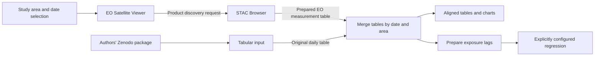

# EO discovery and tabular integration for the NYC asthma example

_Created 2026-11-04 · Updated 2026-11-11_

**Created at:** 2026-11-04T13:37:10-05:00 (America/New_York).  
**Last reviewed:** 2026-11-04T13:50:06-05:00 (America/New_York).  
**Status:** Proposed architecture and phased research/implementation plan. No implementation or live EO acquisition is established by this note.  
**Intended location:** `docs/research/eo-stac-nyc-architecture-and-plan-2026-11-04.md` in Fieldwork.  
**Scope:** Two discovery widgets, a prepared EO table, and a downstream merge with the NYC example's Zenodo table; explicit pathways for NO₂, PM2.5 and ozone.

## 1. The question and proposed answer

Can a practitioner discover remote-sensing products relevant to the NYC asthma example, obtain measurements for its place and dates, and combine those measurements with the original daily emergency department visit table?

The proposed answer is a workflow with two table-producing branches. The existing Tabular input continues to acquire the authors' table from Zenodo. An EO Satellite Viewer helps identify suitable products; a STAC Browser searches and selects observations and prepares a table from their data. A downstream merge combines the tables by date, and by area when multiple areas are present.

The diagram is proposed behavior. Tabular input has no new incoming connection. The STAC widget contains a user-visible **Create table** action backed by reusable acquisition and processing modules. Those modules do not have to become separate palette widgets to support this example.

The first outcome is a comparison of EO measurements with the original series. Substitution into a health model is a later analytical decision, supported by an explicit measurement definition and validation evidence.

## 2. What the inspected repositories provide

The review used these revisions. The three supplied ZIPs matched their corresponding repository contents, allowing for Windows line endings.

| Repository | Inspected revision | Relevant capability and gap |
| --- | --- | --- |
| [Fieldwork][fw] | `ad25d50640571e94c4c301d085092a7f33dcdc04` | Tabular input emits `table` and has no input ports. Table operations, provenance and workflow execution exist. Direct STAC acquisition and a general numeric-measure merge are not established. |
| [NYC worked example][nyc] | `0f32f9b1550ecc9e561bc6e11ec205a4f9b7fcea` | Four workflows use a remotely acquired, digest-checked daily table covering 2016–2025. |
| [EO Satellite Guide][eo] | `684833c9013bfa003bddeb7ff20edb2d4fad3347` | Curated concepts, missions, products and collection routes. NO₂ and aerosol discovery exist; ozone needs an explicit curated route. |
| [STAC Browser][stac] | `945d8b31c59e2cf93f9e51e855eb062fb1b4321c` | Metadata search, asset selection, a Fieldwork selection export and bounded GeoTIFF cropping. Atmospheric NetCDF/HDF extraction into daily pollutant tables remains to be built. |

The example expects 3,653 daily records. Its original variables include `count`, `o3`, `pm25`, `no2`, `tmean`, `prcp` and `rh`; individual workflows select subsets. The regression uses prepared lagged/scaled exposures, including `o3_lag02_10`, `pm25_lag02_10` and `no2_lag02_10`. Their definitions must be recovered from the authors' dictionary and code before calculating equivalents.

The ZIP contains the project and acquisition description, not the health counts. The existing Zenodo acquisition and redistribution boundary remains relevant to any example package generated from this work. [Example documentation][nyc]

Fieldwork's [experiment 91][exp91] already examines STAC integration and browser access. This note builds on that investigation. Its dated findings should remain available; new measurements should be recorded as later evidence.

## 3. Architecture and contracts

### 3.1 EO Satellite Viewer widget

**Practitioner task:** Choose an observable, compare products and select a route appropriate to the study.

Carry the study area and date interval through the interaction. Reuse Fieldwork's area selection rather than introducing an independent boundary that can drift. Let the user inspect instrument, platform, product version, coverage, resolution, measurement meaning and access conditions.

**Proposed output:** A versioned discovery request containing the observable, candidate product, catalog endpoint, collection identifier, area reference, interval and source documentation. A new port type is a candidate for admission review, not an already registered contract. Selecting a mission does not assert that observations exist or that a product suits the health question.

The STAC widget should also support a directly configured catalog/collection, allowing experienced users to bypass mission discovery.

### 3.2 STAC Browser widget

**Practitioner task:** Search, inspect assets, acquire observations and create a measurement table.

The normal sequence is **Search → Select → Check access and variable → Create table → Preview → Use output**. Searches retrieve metadata; creating the table retrieves and processes data. The output port emits a Fieldwork-compatible table only after processing succeeds.

Reuse the existing `fieldwork-stac-selection/1` profile as evidence for selected assets, after reviewing its schema. It is currently a file-based metadata handoff, not a table or a native workflow import. A time series requires multiple selections, an explicit item manifest, and completeness accounting; exporting the currently loaded page is insufficient. [Handoff contract][handoff]

Record catalog paging limits, requested and retrieved intervals, duplicate/reprocessed granules, and any missing pages. A bounded test may intentionally retrieve a short interval, but it must report that bound.

Implement acquisition and processing as separate internal modules:

1. Provider access, authentication and bounded download/subsetting.
2. Format decoding and product-specific variable selection.
3. Quality flags, missing values, scale/offset and permitted unit conversions.
4. Spatial intersection and aggregation over the declared NYC boundary.
5. Temporal aggregation and table construction.

The UI can remain one widget while these stages retain separate provenance. Existing GeoTIFF cropping is reusable only for compatible products. NetCDF groups, HDF variants, irregular swaths, vertical profiles and quality bitfields require explicit readers or a documented provider subset service.

### 3.3 EO table and measurement dictionary

The practitioner-facing view is one row per area and analysis date, with distinctly named measurement columns. Examples are `no2_tropospheric_column`, `aod_550nm`, `pm25_surface_estimate` and `o3_total_column`. These are proposed local names; map them to exact provider variables and controlled terms before use.

| Required information | Purpose |
| --- | --- |
| Date, interval and time basis | Explain which observations belong to a day; distinguish UTC, local civil time and provider-defined days. |
| Area identifier and boundary revision | Identify the spatial support of the summary. |
| Measurement identifier, value and unit | Preserve the physical quantity and any vertical layer or wavelength. |
| Spatial and temporal statistic | Distinguish area-weighted mean, sampled daytime mean, daily mean and maximum. |
| Valid coverage, observation count and status | Distinguish a value from a poorly sampled day, no observation or a processing failure. |
| Product, version and lineage reference | Trace each output to source assets, processing choices and code version. |

Store detailed lineage in an associated manifest, with references from the table or measurement dictionary. Distinguish no acquisition, cloud/QA rejection, insufficient coverage, access failure and reader failure. A numeric zero is never the default for missing data. Do not treat valid-pixel count as a percentage without defining its denominator.

**Internal representation requires an early design decision.** Fieldwork's `DataTable` is long-form: key fields and one numeric value per row. Existing NYC workflows also carry numeric covariates in key fields. A new wide object with arbitrary numeric columns is not automatically compatible with those consumers. Phase 0 must demonstrate the adapter or contract extension for table display, charting, merging, export and regression, including measurement-specific units. Do not force mixed quantities under one table-wide unit.

The inspected input path caps tables at 20,000 rows. Seven measures across 3,653 dates produce 25,571 long-form rows. Evaluate this limit explicitly before promising a full-period, all-variable table. Use bounded windows for the pilot; any capacity change needs measured memory, storage and consumer behavior. [Table model][tablemodel]

### 3.4 Merge widget

**Proposed operation:** Add selected EO measures to the original daily records using an explicit key and join policy.

The initial policy is a left join from the Zenodo table, preserving its dates and outcome counts. Match canonical dates exactly, with area identifiers included when needed. Inspect the original daily time definition before declaring the two series aligned. Spatial comparability also needs a declared boundary and aggregation method even when the table has only one city.

Before committing, preview matched dates, dates missing EO observations, right-only dates, duplicate keys and naming conflicts. Require one prepared value per date/area/measure. Multiple source observations must be resolved by the extraction recipe; an accidental many-to-many join must not multiply the ED counts.

Keep original pollutant fields and add EO measures under distinct names. Record an explicit choice before dropping dates or replacing a measure. Preserve nulls and their reasons; any later model exclusion must report the resulting sample.

Fieldwork's current `relate_table` brings a category/key column, and `append_rows` stacks rows while checking value fields and units. Neither should be silently widened into the proposed numeric-measure merge. Review reuse at the internal operation level and admit a new widget only where the distinction requires one. [Relate implementation][relate] · [Append implementation][append]

### 3.5 Cached data and reproducibility

Freeze the selected assets, area, dates and recipe when acquisition starts. Cancel or invalidate pending work after a relevant edit; retain the last successful result with its original identity until a new result is committed.

Store the prepared table, manifest, input/output digests and recipe locally. Rerunning downstream analysis should use that stored table. Re-extraction additionally requires retained source bytes or reproducibly obtainable subsets; storing only the output does not establish offline re-extraction. Record which capability is available.

Provider sign-in, CORS, signing and file-size limits are product-specific. Check real asset bytes in a browser before labeling a route downloadable. Keep credentials out of exports and receipts. A documented manual download/import path may support a pilot, but must be labeled as manual rather than a completed direct-acquisition path.

### 3.6 Format support and access strategy

**Added 2026-11-04:** Format support is an explicit part of product admission and implementation. STAC describes and locates assets; it does not decode their scientific data. A `.nc`, `.zarr` or `.tif` suffix is not enough to establish reader compatibility.

Keep three responsibilities separate inside the STAC widget:

**Access adapter → format reader → product-specific measurement recipe → common EO table.**

The access adapter obtains bytes or chunks. The reader exposes arrays, dimensions and attributes. The recipe selects the physical quantity and applies its quality, spatial and temporal rules. The downstream merge sees the common table, so adding a supported format should not require another merge implementation.

| Format family | Required capability | Proposed priority |
| --- | --- | --- |
| NetCDF classic / NetCDF-4 | Detect the encoding and data model; read selected groups, variables and dimensions with supported compression. NetCDF-4 uses HDF5 storage, so a classic-only reader is insufficient. | First where required by the selected NO₂ product; admit tested variants only. |
| Zarr v2 / v3 | Read store metadata, selected arrays and necessary chunks; check format version, codecs, chunk layout and any sharding. Usually access a store rather than download one file. | Evaluate in Phase 1; implement when an admitted product uses it or it materially improves bounded access. |
| GeoTIFF / COG | Read supported bands, grid, CRS, scale/offset and NoData. COG enables selective access through its organization and HTTP Range support. | Reuse the Browser's tested subset of capabilities; do not infer support for every TIFF. |
| HDF4/HDF-EOS2 and HDF5/HDF-EOS5 | Handle the specific container and EOS structures, geolocation and attributes. Support for one family does not establish another. | Add when an admitted OMI/MAIAC product requires it, or evaluate a documented provider subset route. |
| GRIB | Decode the required edition, parameter tables, levels, packing and time/forecast semantics. | Conditional on a selected meteorological or atmospheric model product. |
| CSV / Parquet | Read prepared tabular measurements and retain their associated dictionary and lineage. | Useful import/cache/export formats; conversion cannot restore discarded scientific metadata. |

Format references: [Unidata NetCDF FAQ](https://docs.unidata.ucar.edu/netcdf-c/current/faq.html), [Zarr v2 specification](https://zarr-specs.readthedocs.io/en/latest/v2/v2.0.html), [Zarr v3 specification](https://zarr-specs.readthedocs.io/en/latest/v3/core/index.html), and [OGC COG standard](https://docs.ogc.org/is/21-026/21-026.html).

An array format does not by itself specify the scientific interpretation. Apply CF conventions where declared, together with the product dictionary. Confirm coordinate order, time/calendar encoding, vertical dimension, wavelength, fill values and masks. Handle packed values in the documented order and apply scale/offset exactly once. Regular grids and geolocated swaths need different spatial handling even when both arrive as NetCDF.

**Browser execution:** use workers for decoding and aggregation, bounded concurrency, cancellation, and limits on transferred bytes, decoded memory, requests and elapsed time. Choose a JavaScript, WebAssembly or browser-Python reader only after a real-file feasibility test. Availability in desktop Python does not establish availability or efficient remote I/O in JupyterLite.

For each route, measure the access strategy: bounded whole-file download, verified remote subset/range access, chunk-store access, or a provider processing service. Range requests alone do not prove efficient NetCDF/HDF subsetting. Zarr chunks can still be too large for a small NYC request, or require excessive requests; access permissions and codecs must work for every required object. Record provider-side processing and any regridding in the recipe. An external service is an explicit dependency, not an invisible browser fallback.

**Caching and identity:** for a file, record its digest and the reader version. For a multi-object store, record the dataset/version, metadata and selected object keys with available version identifiers and digests for acquired content. A store URL alone cannot identify an immutable extraction. Distinguish complete extraction, partial coverage and failed requests; never interpret an access error as a scientific missing value merely because the storage format permits absent chunks.

**Admission evidence:** maintain a matrix keyed by product version, container variant, codecs, access strategy and tested browser. Check one small real sample and an independent numerical result, including masks, coordinates, units and quality flags. Where the same product is available in two encodings, compare equivalent subsets before claiming format-independent results. Unsupported variants remain inspectable metadata with a precise acquisition limitation.

Do not convert every source into GeoTIFF as a universal intermediate: time, vertical levels, swath coordinates and quality arrays may need preservation. The shared integration boundary is the prepared measurement table and its provenance.

## 4. Variable-specific implementation tracks

All routes below are candidates until the exact product/version, coverage, access and numerical extraction pass Phase 1. The full 2016–2025 interval must not be inferred from a mission name or filled by silently combining instruments.

| Track | Initial discovery candidates | Intended output and decisions |
| --- | --- | --- |
| NO₂ | Existing Guide routes for OMI, TROPOMI and TEMPO | Begin with a documented tropospheric column series for a bounded interval. A surface NO₂ estimate is a separate product/method. |
| PM2.5 | MODIS MAIAC or another documented aerosol product for context; separately evaluate satellite-informed surface PM2.5 products | AOD remains AOD. A PM2.5 series requires a product already estimating surface mass concentration or a separately validated estimation model. |
| Ozone | Add curated total-column/profile routes for suitable OMI, TROPOMI or TEMPO products; separately evaluate surface ozone products | Keep total column, tropospheric/partial column and surface concentration distinct. A near-surface layer is not automatically the original daily surface statistic. |

### NO₂

Use the Guide's existing routes as discovery starting points, not proof of current access. Choose one product and a short interval with usable observations over NYC. Read its exact variable/group, units, quality flags, cloud treatment, fill values and uncertainty information. Account for swath footprints and overlaps rather than treating latitude/longitude arrays as a regular image by default.

Produce a daily spatial summary that states its actual sampling, for example a summary of valid daytime overpass observations. Compare numerical results with an independent extraction. A later surface-concentration track needs its own model assumptions and validation; a column-to-ppb conversion is not a simple unit conversion.

### PM2.5

Implement two explicitly labeled pathways:

1. **Aerosol context:** extract quality-filtered AOD with wavelength, sampling and coverage. Add it as an explanatory EO variable for comparison with the original `pm25` series.
2. **Surface PM2.5 estimate:** select a documented satellite-informed product covering NYC at the required temporal resolution, preserving its model version, units, uncertainty and dependence on monitors or meteorology.

Monthly or annual surface estimates cannot supply independent daily variation for this example. Do not repeat them across days and present the result as daily observations. If no suitable daily product passes access and suitability review, complete the AOD branch and record the daily surface-PM2.5 branch as unresolved. Developing a new AOD-to-PM2.5 model is a separate research task, including calibration, out-of-sample assessment and checks on extreme smoke conditions.

### Ozone

Add an ozone concept and product routes to the Guide, separating total column, profile/partial column and surface concentration. A column/profile branch may provide atmospheric context. For an exposure-comparison branch, identify a suitable surface ozone product and verify its vertical support, units and daily statistic against the authors' dictionary.

A daily mean, a daily maximum and a daily maximum rolling eight-hour average are different variables. Deriving the latter requires adequate within-day sampling and documented window/completeness rules. Daytime satellite observations alone must not be presented as complete hourly coverage. Model or assimilation products may be useful candidates, but must be labeled as such and evaluated at their actual resolution.

### Weather and later variables

The original table also has temperature, precipitation and relative humidity. Preserve them in the initial extension. A later optional track may acquire comparable meteorological products after checking daily definitions, temperature height, precipitation accumulation intervals and humidity definition. Land-surface temperature would be an additional EO variable, not an automatic replacement for air temperature.

The ED outcome continues to come from the authors' table; this design introduces no remote-sensing estimate of visits.

## 5. Phased implementation plan

Phases produce evidence and can revise the architecture. They are not calendar estimates. NO₂ provides the first end-to-end path; PM2.5 and ozone each have their own completion criteria.

| Phase | Work and deliverable | Exit evidence |
| --- | --- | --- |
| **0 — Define the study and contracts** | Recover original variable/lag definitions; choose area, time basis and pilot interval. Review the table representation, merge semantics, units, provenance and capacity. Write a numbered experiment and admission review before introducing primitives. | Reviewed contracts plus a small composition fixture demonstrating expected table shapes and downstream compatibility. Unsettled scientific choices are listed explicitly. |
| **1 — Prove access for all three tracks** | Build a source matrix for NO₂, PM2.5 and ozone: product/version, archive coverage, resolution, measurement type and documentation. Add the format/access matrix from section 3.6, including NetCDF variants, Zarr versions/codecs, and memory/request budgets. Attempt bounded metadata and actual-byte reads and decode selected values in a browser. | At least one usable NO₂ route; separate ready/conditional/unavailable findings for PM2.5 and ozone. No discovery-only success counted as acquisition. Pin reference files or store manifests where redistribution permits; identify readers and unresolved format gaps. |
| **2 — Build table preparation and merge** | Implement the table adapter, measurement dictionary, manifest and numeric merge using small deterministic fixtures. Add duplicate-key, missing-date, collision and unit handling. | Independently calculated expected outputs; unchanged left-side counts/dates; no multiplication of outcomes; serialization and consumer checks. Fixtures establish software behavior, not EO suitability. |
| **3 — Complete the NO₂ path** | Adapt the EO Guide and STAC Browser into Fieldwork widgets, reuse one area selection, implement the admitted access adapter, format reader and NO₂ recipe, cache output, and connect the merge to the NYC comparison workflow. | Real observations travel through both widgets into a merged table and chart; values agree with an independent extraction within declared tolerances; replay works from retained data. Access failures, unsupported encodings, resource limits and stale selections are exercised. |
| **4 — Add PM2.5 pathways** | Add AOD context and, where Phase 1 supports it, a separate daily satellite-informed surface-PM2.5 route. Include product/model provenance and uncertainty. | AOD and PM2.5 retain distinct names, units and meanings; real-data extraction is checked; suitable daily coverage is demonstrated or the surface branch remains explicitly unresolved. |
| **5 — Add ozone pathways** | Add ozone discovery concepts, supported column/profile extraction and a separately reviewed surface-ozone route where feasible. Implement the selected temporal statistic. | Vertical support and daily statistic are preserved; numerical extraction is independently checked; inadequate time coverage cannot yield a falsely complete exposure statistic. |
| **6 — Extend time coverage and analysis** | Evaluate the full period and cross-product comparability, storage and long-table capacity. Recompute lags from complete calendars, configure new models explicitly, and compare source/coverage sensitivity. | Missing dates do not become adjacent-day lags; retained dates and model sample are reported; original reproduction remains available; new models are identified as new analyses. |
| **7 — Practitioner evaluation and documentation** | Observe a practitioner finding a product, recognizing its measurement type, interpreting missing coverage and reviewing a merge. Update manuals, example, experiment records and resource mappings. | Record observed tasks, misunderstandings and revisions. Technical checks, scientific suitability and practitioner usefulness receive separate conclusions. |

Phases 4 and 5 can proceed independently after the shared pipeline works. Neither is complete merely because the NO₂ implementation passes. A failed source evaluation is an actionable result, not a reason to substitute a scientifically different product silently.

## 6. Ontologies, vocabularies, glossaries and data dictionaries

This is a broad, task-oriented inventory of authoritative resources checked or identified on 2026-11-04. It does not claim to enumerate every EO vocabulary. Ontologies, metadata specifications, glossaries and product dictionaries serve different purposes; listing a resource does not establish a mapping or require importing it in full.

### 6.1 Semantic modeling and validation

| Resource | Type and proposed use |
| --- | --- |
| [SOSA/SSN](https://www.w3.org/TR/vocab-ssn/) | Observation ontology: observed property, feature of interest, sensor, procedure and result. Distinguish the original retrieval from the derived city/day summary. |
| [PROV-O](https://www.w3.org/TR/prov-o/) | Provenance ontology: input entities, extraction/aggregation/merge activities, software and attribution. |
| [DCAT 3](https://www.w3.org/TR/vocab-dcat-3/) | Catalog vocabulary: datasets, distributions and services. Supports discovery and access descriptions without asserting measurement equivalence. |
| [SKOS](https://www.w3.org/TR/skos-reference/) | Concepts, preferred/alternative labels, hierarchies and qualified mappings. Useful for pollutant search and curated product routes. |
| [GeoSPARQL](https://www.ogc.org/standards/geosparql/) | Geometry and spatial relationships. Keep study boundary, metadata footprint and actual acquired support separate. |
| [OWL-Time](https://www.w3.org/TR/owl-time/) | Instants and intervals for acquisitions and summaries. Timezone/day rules still need executable handling. |
| [QUDT](https://qudt.org/) | Quantity kinds, dimensions and units. Check physical meaning as well as dimensional compatibility. |
| [SHACL](https://www.w3.org/TR/shacl/) | RDF validation rules for required fields and allowed combinations; passing shapes does not establish scientific validity. |
| [SWEET](https://github.com/ESIPFed/sweet) | Earth/environmental ontologies for relevant atmospheric and physical concepts. Review individual terms before adopting mappings. |
| [ChEBI](https://www.ebi.ac.uk/chebi/) | Chemical entity ontology for substances such as nitrogen dioxide and ozone. Substance identity alone does not identify column, concentration or averaging interval. |
| [ENVO via EBI OLS](https://www.ebi.ac.uk/ols4/ontologies/envo) | Candidate environmental-context ontology. The landing application was reachable but term content requires a subsequent lookup; no specific term mapping is asserted here. |

A small application profile should reuse selected terms from these resources. Preserve the existing [EO Guide profile][eoprofile] and Fieldwork's experimental [STAC vocabulary][fwstac] as implementation evidence, while reviewing their assumptions and mappings. Do not assert equivalence simply because two labels match.

### 6.2 Scientific variables, metadata and units

| Resource | Type and proposed use |
| --- | --- |
| [CF Metadata Conventions](https://cfconventions.org/) | NetCDF variable meaning, coordinates, bounds, calendars, flags and aggregation metadata. |
| [CF Standard Name Table](https://cfconventions.org/Data/cf-standard-names/current/build/cf-standard-name-table.html) | Controlled physical-quantity names and canonical units; pin the table version used by each mapping. |
| [NERC Vocabulary Server](https://www.bodc.ac.uk/resources/vocabularies/) | Managed vocabularies and persistent concept identifiers. Useful for documented semantic crosswalks. |
| [NVS P07](https://vocab.nerc.ac.uk/collection/P07/current/) | Linked-data representation of CF standard names. Record version correspondence with the CF source. |
| [BODC P01 parameter dictionary](https://www.bodc.ac.uk/resources/vocabularies/parameter_codes/) | Detailed parameter descriptions; evaluate relevant terms instead of assuming a marine-focused dictionary covers every atmospheric retrieval. |
| [GCMD Keyword Viewer](https://gcmd.earthdata.nasa.gov/KeywordViewer/) | Earth-science topics, instruments and platforms for discovery. Keywords do not replace variable definitions. |
| [NASA CMR/UMM metadata guidance](https://wiki.earthdata.nasa.gov/spaces/CMR/pages/148735360/CMR%2BMetadata%2BBest%2BPractices%2BLanding%2BPage) | Collection/granule metadata concepts and quality guidance for NASA discovery records. |
| [ACDD](https://github.com/ESIPFed/acdd) | Discovery attributes for NetCDF datasets, complementing CF's scientific metadata. |
| [UDUNITS](https://www.unidata.ucar.edu/software/udunits/) | Unit database and compatible-unit conversion reference. Cannot supply missing atmospheric information for column-to-surface inference. |
| [STAC extensions registry](https://stac-extensions.github.io/) | EO, projection, raster, datacube, scientific, processing and access-related extensions where declared by the source. Check schema version and maturity; absent metadata must remain unknown. |
| [WMO Codes Registry](https://codes.wmo.int/) | GRIB, BUFR and WIGOS-related codes, particularly relevant to weather and modeled atmospheric products. |
| [CEDA/STFC vocabulary service](https://vocab.ceda.ac.uk/) | CCI/GCOS quantities, platforms, sensors, products, processing levels and a linked glossary. Useful beyond the initial air-quality case. |

For catalog and access protocol work, use the [STAC specification](https://github.com/radiantearth/stac-spec) and [STAC API specification](https://github.com/radiantearth/stac-api-spec) already referenced by the Browser. Metadata conformance and successful data access require separate tests.

### 6.3 EO practice, instrument descriptions and terminology

| Resource | Proposed use and qualification |
| --- | --- |
| [KCEO EO Glossary](https://ec-jrc.github.io/KCEO-Glossary/) | Practitioner definitions and cross-links across EO communities. The source identifies itself as work in progress and not fully reviewed. |
| [CEOS Earth Observation Handbook](https://eohandbook.com/) | Missions, instruments, capabilities and application context, with access to the CEOS mission/instrument database. |
| [CEOS Interoperability Handbook](https://github.com/ceos-org/interoperability-handbook) | Vocabulary, architecture, interfaces, quality and policy guidance for connecting the components. |
| [WMO OSCAR](https://space.oscar.wmo.int/) | Observing requirements and satellite/instrument capabilities; supports product comparison rather than claiming archive availability. |
| [OGC Observations, Measurements and Samples](https://www.ogc.org/standards/om/) | Conceptual observation terminology and models to compare with the RDF profile. |
| [OGC SensorML](https://www.ogc.org/standards/sensorml/) | Sensor and process descriptions; candidate reference for retrieval/procedure metadata. |
| [NASA air-quality interpretation guidance](https://airquality.gsfc.nasa.gov/sites/default/files/airquality/1-s2.0-S1352231014004270-main.pdf) | Scientific interpretation of satellite air-quality measurements and common errors. This is methodological literature, not a current product-availability catalog. |

The local glossary should initially define: observable, retrieval, granule, STAC Item, asset, processing level, column density, mixing ratio, mass concentration, AOD, wavelength, averaging kernel, quality flag, swath, footprint, spatial support, revisit versus sampling interval, daily statistic, coverage, uncertainty, modeled estimate and assimilation. Each entry needs a source and a scope note relevant to the widget.

### 6.4 Product dictionaries and pollutant-specific references

| Resource | What to obtain before implementing a reader |
| --- | --- |
| [Sentinel-5P document library](https://sentiwiki.copernicus.eu/web/s5p-documents) | Product user manuals, file-format descriptions, algorithm documents and quality information for the exact NO₂/ozone product version. |
| [TEMPO product descriptions](https://tempo.si.edu/data_for_scientists.html) | Distinguish NO₂ columns, total ozone and ozone profiles and locate product access/documentation. |
| [TEMPO trace-gas/cloud user guide](https://asdc.larc.nasa.gov/documents/tempo/guide/TEMPO_Level-2-3_trace_gas_clouds_user_guide_V2.1.pdf) | Version-specific variable and quality information for its stated NO₂/HCHO/cloud scope; obtain separate ozone documentation rather than assuming this guide covers it. |
| [MODIS MCD19A2 product page](https://ladsweb.modaps.eosdis.nasa.gov/missions-and-measurements/products/MCD19A2/) | MAIAC product identity, grid and temporal description. Obtain the collection-specific user guide, science-data-set dictionary and QA bit definitions as Phase 1 deliverables. |
| [CAMS global atmospheric-composition forecasts](https://www.ecmwf.int/en/forecasts/datasets/cams-global-atmospheric-composition-forecasts-1) | Candidate model-product context. Resolve exact parameter, vertical level, forecast/reanalysis identity and archive interval before considering NYC use. European regional products do not cover NYC. |
| [EPA AQS code lists](https://www.epa.gov/aqs/aqs-code-list) | Parameters, units, methods, durations and qualifiers for potential monitor comparisons. Monitor observations remain independently identified from EO products. |
| [NYC example source description][nyc] | Entry point to the authors' reproducibility package, data dictionary and exposure/lag definitions. These govern interpretation of the existing columns. |

For every admitted product, preserve the file's own attributes and exact variable path alongside documentation: dimensions, coordinates, units, fill/missing values, valid ranges, scale/offset, flags, vertical support, wavelength where relevant, uncertainty, sampling and processing version. Conflicts between file metadata and documentation require review. A generic glossary cannot resolve them automatically.

Additional resource families to investigate as the scope grows include ISO 19115/19157/19156 metadata and quality models; OGC EO metadata profiles and definition registers; EPSG reference-system definitions; UCUM and OM unit resources; GEOMS atmospheric-validation metadata; AERIS vocabularies; ESA CCI product dictionaries; and DataCite/Dublin Core citation metadata. These are follow-up leads, not reviewed implementation dependencies. This review did not establish usable content at the attempted GEOMS and AERIS endpoints. A candidate satellite-informed PM2.5 supplier page also could not be retrieved, so no daily product or STAC route is endorsed from it.

### 6.5 Resource adoption and mapping workflow

Maintain a resource register with title, owner, canonical URL, type, version, access date, license, scope, maintenance status and adoption decision. Link to terms where redistribution conditions have not been checked. Pin the versions actually used in an experiment; retain dated records when mappings change.

For each output measure, curate a crosswalk:

**Provider variable/version → physical quantity and qualifiers → controlled term → unit → Fieldwork measure → permitted analytical uses.**

Use SKOS mappings only where their stated relationship is justified. A broad discovery relationship should not become `owl:sameAs`. Keep chemical identity, measurement quantity, retrieval procedure and application suitability as separate assertions.

Phase 0 establishes the minimal profile and glossary. Phase 1 captures source dictionaries. Each pollutant phase adds its mappings and positive/negative fixtures. Phase 7 tests whether practitioners understand the labels and distinctions. Example negative cases are AOD labeled as PM2.5, total ozone labeled as surface ozone, and a daily overpass summary labeled as a complete daily mean.

## 7. Validation and recording results

| Evidence layer | Required observations |
| --- | --- |
| Structure and contracts | Widget registry, palette reachability, compatible ports, table representation, measurement dictionary, serialization and positive/negative semantic checks. |
| Numerical processing | Independent extraction of real source values; scale/offset, fill values, QA, partial pixels, overlap, time bins and aggregation tested against declared expectations/tolerances. |
| Browser acquisition | Named browser/version, actual provider requests, authentication, CORS, bounded download, cancellation and storage behavior. Metadata access alone is insufficient. |
| Connected workflow | Real EO table merged with the locally acquired example; original date/outcome totals conserved; chart and regression consumers interpret the declared fields correctly. |
| Scientific suitability | Measurement support, sampling bias, uncertainty, comparability and independent reference evaluation. Correlation with the original exposure series is descriptive and not by itself validation. |
| Practitioner use | Observe whether a practitioner distinguishes columns from concentrations, notices missing coverage, and understands the merge's retained sample. Record these questions before observing results. |

At implementation, follow the then-current Fieldwork [widget procedure][widgetprocedure], [semantic admission audit][admission] and validation/gating instructions. Run targeted checks during development and the required repository gates for the actual change. Report exactly which browsers ran. A research note does not itself require an application-wide test run.

Record dated outcomes, failed attempts, remaining gaps and any revised decisions in the experiment series. The research note remains the architecture reference; experiment records establish what was tried and what the evidence supports.

## 8. Review status and immediate decisions

**Established in this review:** repository source inspection, the current table/Relate/Append contracts, inspection of the example project and provenance metadata, archive-content comparison, and the reference discovery described above.

**Still unestablished:** live EO asset acquisition, product-specific numerical extraction, table-merge implementation, browser execution of the proposed graph, suitability of replacement exposures and practitioner effectiveness.

The next experiment should settle the original daily definitions, one NYC boundary, a short NO₂ interval, the internal table representation and the access feasibility matrix for all three pollutants. It should name the PM2.5 and ozone deliverables independently so that success on the first pathway cannot close the remaining work.

[fw]: https://github.com/digital-twin-ph/fieldwork/tree/ad25d50640571e94c4c301d085092a7f33dcdc04
[nyc]: https://github.com/digital-twin-ph/example-2025-nyc-ozone/tree/0f32f9b1550ecc9e561bc6e11ec205a4f9b7fcea
[eo]: https://github.com/jltobias/JupyterLite-EO-Satellite-Guide/tree/684833c9013bfa003bddeb7ff20edb2d4fad3347
[stac]: https://github.com/jltobias/JupyterLite-STAC-Browser/tree/945d8b31c59e2cf93f9e51e855eb062fb1b4321c
[exp91]: https://github.com/digital-twin-ph/fieldwork/blob/ad25d50640571e94c4c301d085092a7f33dcdc04/docs/experiments/91-stac-browser-integration.md
[handoff]: https://github.com/jltobias/JupyterLite-STAC-Browser/blob/945d8b31c59e2cf93f9e51e855eb062fb1b4321c/book/fieldwork-integration.md
[tablemodel]: https://github.com/digital-twin-ph/fieldwork/blob/ad25d50640571e94c4c301d085092a7f33dcdc04/src/data-table.ts
[relate]: https://github.com/digital-twin-ph/fieldwork/blob/ad25d50640571e94c4c301d085092a7f33dcdc04/src/relate-table.ts
[append]: https://github.com/digital-twin-ph/fieldwork/blob/ad25d50640571e94c4c301d085092a7f33dcdc04/src/append-rows.ts
[eoprofile]: https://github.com/jltobias/JupyterLite-EO-Satellite-Guide/blob/684833c9013bfa003bddeb7ff20edb2d4fad3347/data/research-ontology.ttl
[fwstac]: https://github.com/digital-twin-ph/fieldwork/blob/ad25d50640571e94c4c301d085092a7f33dcdc04/ontology/stac.ttl
[widgetprocedure]: https://github.com/digital-twin-ph/fieldwork/blob/ad25d50640571e94c4c301d085092a7f33dcdc04/widgets/README.md
[admission]: https://github.com/digital-twin-ph/fieldwork/blob/ad25d50640571e94c4c301d085092a7f33dcdc04/docs/audits/ontology-audit.md
