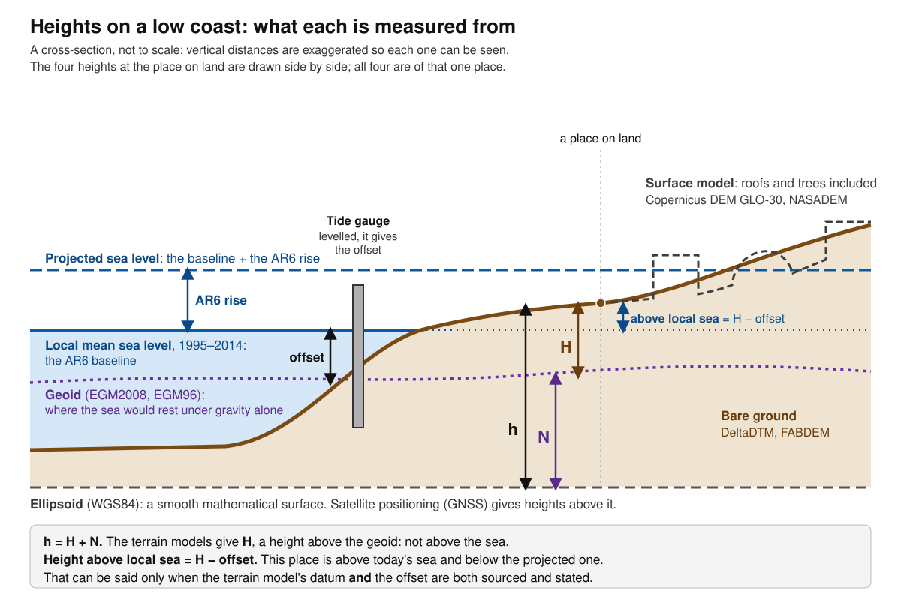

# Tabular data

_Created 2026-11-02 · Updated 2026-11-20_

**A source.** It reads a CSV, Excel or Stata file into a table.

## What it does

It reads a CSV, Excel (`.xlsx`) or Stata (`.dta`) file in wide or long shape and hands a table to the next step. An absent value is kept as
unknown, never read as zero.

## How to use it

The Inspector says in one sentence what the step reads: the file, its shape, its value columns and its unit. **Configure…**
opens the import.

1. Choose where the table comes from, in the tabs **Your file**, **From an address**, **Census tables**, **Tide gauges** or **DHIS2**, and say
   whether it is wide or long.
2. Tick the key columns and choose the value column or columns.
3. Under **What identifies a row?**, mark any primary and secondary keys.
4. **Apply.** Nothing changes until you do; **Cancel** or **×** leaves the step as it was.

After it, the Inspector's **Result** says how many rows were read and how many values are absent, what Data quality
found, and how many columns are described, with **Quick look at the table**, **Data quality** and **Describe
columns…**. If it names a Data quality finding, open it before relying on the table.

**Convert the source table on each run**, in the dialog, keeps the file as published and melts it when the workflow
runs, so the run's receipt names the columns it took. It can be changed without reading the file again.

## Excel workbooks

A workbook of several sheets offers **Sheet**: choose the one holding the table, and it is set up as a CSV is. The
dialog says which sheet it read, and the step keeps it, so a table fetched again reads the same sheet. Cells are read
as written: a formula gives its saved result, and formatting is ignored, so a date Excel stores as a number stays that
number. An older `.xls` file needs saving as `.xlsx` or CSV first.

## Stata files

A Stata file, from Stata 8 onward, is read as Stata wrote it and then set up as a CSV is. Numbers are as stored. A
missing value, `.` or `.a` to `.z`, is empty, never zero. A variable Stata formats as a date is read as a date. Value
labels are not applied: codes stay as stored, and the import says which variables carry labels.

## From an address

In the tab **From an address**, give the address of a CSV, a Stata file or a zip, and **Fetch**. For a zip, choose
the file inside. The table is then set up as any other.

The project keeps where the table came from, the URL, the file inside and the digests, in place of its rows. An
exported project carries no rows, so sharing it does not republish data whose terms do not allow that. On another
device the step says its rows are not fetched yet, and **Fetch the table**, under Result, reads the same file again
with the same settings. A file whose digest has changed is refused, and nothing is read.

**Downloaded once per device.** What is fetched is kept on the device by its digest. Any table, in any project on the
device, that names the same file reads it from there, checked again, instead of downloading it. Typed again in the
dialog, a URL reads the copy and says when it was fetched; **Fetch again from the source** checks for a newer file. A
source that has not finished after two minutes is stopped and said to be late.

## Census tables

The tab **Census tables** lists the countries in [census-tables](https://github.com/digital-twin-ph/census-tables),
counts as each national statistics office published them. For each it says the census, how many rows, the publisher,
the terms of use and when the table is next reviewed. A table past its review date says so, and is still offered.

Choose a country. Its counts are fetched by address, as in **From an address**, and its data dictionary with them, so
what each column holds is proposed for you to accept. Both are fetched at the commit this version of Fieldwork names,
and each is checked against the digest recorded with it: a file that differs is refused, and nothing is kept.

Each country is offered in the units today's maps use. Where its census counted other units, the table offered is
summed from them and says so: DR Congo's only census, of 1984, counted 9 regions and 44 cities and sub-regions
(KIVU, SHABA) that match no map today, so it is offered **Summed to today's 26 provinces (2015)**, with each
province's name as geoBoundaries spells it (`geoboundaries_name`) to relate to a map of today's provinces. Its counts
are still 1984's. The line beside it links to the counts as printed, kept in the repository as the source, with how
each unit was placed and what the placing does not establish. Rwanda's and Botswana's districts are offered the same way, each
with the name geoBoundaries gives it in `geoboundaries_name`: Rwanda's are the census's own, and 8 of Botswana's are
spelled differently.

## Tide gauges

The tab **Tide gauges** lists the coastal countries in
[coastal-sea-level](https://github.com/digital-twin-ph/coastal-sea-level), with a map of every gauge above them: filled
where PSMSL computes a long-term trend, hollow where it holds the record only. The map is drawn here, with no network.

Choose a country. Its index of its gauges is read, one row per station, with the data dictionary every country shares,
fetched at the commit this version of Fieldwork names and checked against its digest. Each row gives the station's ID
and name at PSMSL, its position, the years its record covers and how complete it is, the trend PSMSL computes where it
computes one, its numbers at UHSLC, and how fast the land moves at the nearest GNSS station within 15 km, where one is.

**An index, not the records.** The monthly and annual means are at PSMSL, and the hourly and daily values at UHSLC;
neither states terms that allow copying them, so each row links to the station's page, where its record is.

**What a gauge measures.** A tide gauge measures the sea against the land it stands on. Where the land sinks, the gauge
shows more rise than the sea's own; where it rises, less. PSMSL's trends carry no correction for it, and PSMSL says they
are not for planning or policy. A GNSS station near a gauge is not the gauge: the ground can move at different rates a
few kilometres apart. A station on PSMSL's *metric* list is never to be used for a trend.

Cite the archives when using a row: PSMSL (Holgate et al., 2013) and the date of its extraction; UHSLC (Caldwell et
al., 2015); SONEL ULR7a (Gravelle et al., 2023), whose velocities are CC BY 4.0. The repository's README gives each
citation in full.

## DHIS2

The tab **DHIS2** reads a DHIS2 server's analytics: aggregate values by data element or indicator, period and
organisation unit, as a country's DHIS2 holds its routine surveillance.

1. Type the server's address, and choose its token from **Credentials** (provider `dhis2`). The token is never typed
   here and never kept in the project.
2. **Connect.** The tab says which DHIS2 version answered and how many levels of organisation units it has.
3. **Find** data elements and indicators by name, and tick those to read. Choose the level of the units, for example
   *District*, and the periods, for example *the last 12 months, by month*.
4. **Read the table.** It arrives long, one row per data, period and unit, with the names and DHIS2's IDs, its value
   in `value`, and a short data dictionary of its columns for you to accept.

The step keeps where the table came from: the server, the request and when it was read. The units read are the
token's own: those its user is assigned to, and the level below them chosen.

**The server must list this page's address** in its CORS allowlist, which its administrator sets; a public
demonstration server does not. Without it, export a table from DHIS2's Data Visualizer and read it under **Your file**.

The step reopens on the tab its table came through. A new step opens on the tab last used on this device.

## Keys

**A file with more than 12 columns** lists them in a dialog of its own: Key columns shows how many are ticked and which,
and **Choose key columns…** opens the list, with **Columns to keep** (paste or type names, separated by commas, then
**Keep these**), **Find a column**, **Untick all** and **Ticked only**. A name the file does not have is said. Read long,
such a file starts with nothing ticked; a smaller one ticks every column but the value, and lists them inline. Value
columns, for a wide read, work the same way.

Key columns are read as labels. Among them you decide what identifies a row:

| Declaration | Means | Checked |
| --- | --- | --- |
| **Primary key** | One column or several together are unique | Yes |
| **Secondary key** | Groups or links rows, and may repeat | No |
| **Neither** | An answer or category | No |

With no primary key declared, the check is on all the key columns together.

**List the distinct values of** ticks key columns whose values the table lists, for a step that needs them as a list.
**Assign projection site** reads the sites it assigns against from `site_id` here, so tick it on the projections
table. Nothing else changes: the rows are the same.

## What the columns mean

**Describe columns…** on the node opens a dialog for every column the table keeps: a **label**, a **unit** and a
**description**. The column's name stays as the file spells it; the label is shown beside it, in a regression's
terms and a chart's panels. Describing the columns is your step, and a data quality check: a column nobody has
described is a finding in Data quality and in the write-up's Methods, never a reason to refuse the table.

**From a data dictionary.** Under *Propose from a data dictionary*, choose a CSV, Excel workbook or Stata file with one
row per variable, or, for a table fetched from a zip, a file in the same archive (read from this device). Say which of
its columns holds the variable name, label, description, unit and missing count; a first guess from its headers is
filled in. **Propose descriptions** fills the columns it describes, marked *not yet accepted*, and checks it against
the table: which kept columns it does not describe, and whether each missing count it states agrees with the table's.
Accept each proposal, or **Accept every proposal**; typing in a field makes the description yours.

A Stata file's own variable labels are proposed the same way when it is imported.

**Its data dictionary, imported with it.** Configure… takes a second, optional file beside the table: its data
dictionary. The project keeps it, and **View the data dictionary** under Result shows it as it was published. What it
says each column means is proposed, not yet accepted. A dictionary chosen later in Describe columns… is kept the same
way; one inside a fetched archive is not, because the project keeps where a fetched source came from, not its contents.

**What kind of values.** Each column can say its values are *categories in no order*, *categories in an order*,
*numbers with no true zero* or *amounts counted from zero*, and list its codes: `0 = pre-school; 1 = first class`. For
categories in an order, the list is the order. A dictionary written in R's words, *(factor: 0, preschool; 1, 1st
class)*, proposes the codes and **no order**, because a factor is R's word for categories with none; whether they have
one is yours to say. Data quality then counts a column of categories, in its order, with what each code means, and
gives it no median.

## Data quality

A file is not refused for a quality problem. Every row is kept, the step's Result names what Data quality found, and the
**Findings** tab of Data quality lists:

- rows repeating a key value
- rows with no value in a key column
- values that are not numbers, kept as unknown and never as zero

A finding left unresolved goes into the write-up as a machined limitation.

A file with no rows, too many rows or a missing column is still refused, because there is no table to look at.

**Read as wide, a repeated subject is kept.** When the key columns repeat a subject, the dialog says the file may be
long and offers to read it so. Usually it is. But a wide file can repeat a subject because the source has a fault,
and the Brazil dengue file has one week twice for every municipality. Read as wide anyway, every row is kept and
each repeat is a finding in Data quality.

## Editing a value by hand

**Data quality**'s **Records** tab shows the records as the steps after this one read them, a page at a time, each value
in a box. Change a value and leave the box: it is kept as an **edit** on this step, with the value it replaced and when,
and the run applies it to a copy of the records. The file is not changed. An empty value can be filled the same way; such
edits are counted apart, because a supplied value is not a reading. **Edits (n)** lists every edit, newest first, each
with **Remove**, which takes it back.

An edit is applied only where the record still holds the value it was made against. If the data has changed under it,
after a new import, the edit is not applied and Data quality says so. The run's record states each edit, before and
after (`fw:CellEdit`). Experiment 214.

## What it will not do

It does not choose between rows that disagree. The table stays as read until a later step changes it.

## History

### 2026-11-20 · Tide gauges (0.14.0)

The dialog's sources gain **Tide gauges**: the coastal countries in coastal-sea-level, over a map of every gauge, each
country's index of its gauges read with the shared data dictionary at a pinned commit, checked by digest. A column
named *id*, or ending in *_id*, *_code* or *_no*, is offered as a key in a wide read, though written in digits.

A long read can name its value, as a wide read could: DR Congo's census read long gave *total* beside three models'
*population*. A long read reopens with its value column and keys as saved, where the guess had replaced them. **After**
shows the rows as stored, one per key with its value, then the same table as a crosstab. The column a wide read makes
for the variables' names is said as made by the read wherever it is offered.

**DHIS2**, a fifth source: a server's analytics read with a token from Credentials, long, with a dictionary of its
columns, and the step keeping the server and the request.

### 2026-11-20 · Census tables in today's units; a step's choices for its own table (0.13.0)

DR Congo is offered as its 1984 counts summed to today's 26 provinces, with each province's name as geoBoundaries
spells it, so the counts relate to a map of today's provinces; the 1984 units (KIVU, SHABA) match none of them. The
counts as printed are linked, not offered.

A step reopened and given another table starts from that table's defaults. The key and value columns it was saved
with had been carried over by name, so a column that had been a key could not be taken as a value. A step keeps its
choices for its own table: the same address, or a file chosen again. A refused read no longer shows the last table
read beside the refusal.

A table read from an address reopens read, where it opened empty until fetched again. One value column read wide is
advice, not a refusal, so a census's total can be named as the value. The value column is guessed only where it holds
numbers. The data dictionary picker is under **Your file** only: a census table brings its own. The second name box
reads *Name for the column holding variable values*. The unit of the value is taken from the data dictionary where it
states one for the columns read, and said so; typing one replaces it.

### 2026-11-20 · Where the table comes from, as tabs; census tables (0.12.0)

The dialog's sources are three tabs: **Your file**, **From an address** (until now **Or fetch from a URL**, a section
that opened under the file box) and **Census tables**, new. The tab chosen shows only its own controls; what follows,
the shape, the keys and the columns, is the same for all three.

**Census tables** reads a country's counts and its data dictionary from the census-tables repository at a pinned
commit, checked by digest. Three countries to begin with: Botswana (2022), DR Congo (1984) and Rwanda (2022).

The heading no longer repeats the widget's name when the step still has it: "Tabular data", not "Tabular data ·
Tabular data".

### 2026-11-19 · A large table no longer stalls the dialog (0.11.1)

Importing 250,000 rows of points to measure maps, ticking four key columns took over an hour (Chromium, development
Mac). Two causes, both found by profiling one tick:

- **Rows that repeat a key were grouped by copying the group at every row.** With a key of five values over 250,000
  rows, each group was copied tens of thousands of times. They are now added in place; the groups are the same. A
  finding names its first ten rows and how many more, not every row.
- **The table under the dialog drew every row.** At 25,000 rows that was 325,971 elements on the page, and every
  click searched them. It now shows 200 rows at a time, with Previous and Next, as Results does.

After: a tick that rebuilds the table takes 0.4 to 0.6 s at 250,000 rows, measured by unticking and ticking a key
column. A table of 200 rows or fewer looks as it did.

